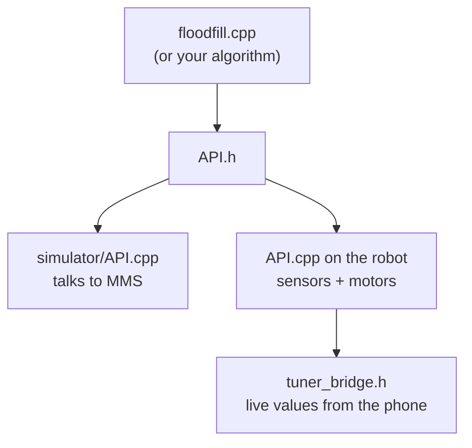
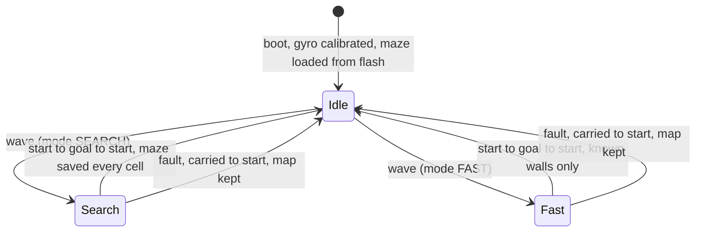

# 🍪 Creamcraker

**An ESP32 micromouse with easy calibration. Finalist of SLIIT ROBOFEST 2026.**

<p align="center">
  
  
  
  
</p>

<!-- 📸 HERO PHOTO: save it as media/hero.jpg, then remove the comment markers around the next three lines
<p align="center"></p>
-->

This README is a maze. Like the mouse, you can explore it cell by cell, or skip straight to the route.

| ⚡ **Fast run** | 🧭 **Search run** |
| --- | --- |
| You already know what you want. Build, tune and race in five steps. | Explore every cell: the story, the body, the brain, the dead ends. |
| **[→ Take the fast run](#fast-run)** | **[→ Enter the start cell](#cell-s)** |

---

<a name="map"></a>

## 🗺️ The map- for the readme. The maze represents several sections of it listed below.

```
+-----+-----+-----+-----+-----+-----+
|  ?                             ?  |
+     +     +-----+-----+     +     +
|     |     |   GOAL    |  ?  |     |
+     +     +           +     +     +
|     |     |   (2x2)      6  |     |
+     +-----+-----+-----+     +     +
|     |  x  |           |  5  |     |
+-----+     +     +-----+     +-----+
|  S     1     2     3     4     p  |
+-----+-----+-----+-----+-----+-----+
```

| Cell | Flood distance | What's there |
| :---: | :---: | --- |
| **[S](#cell-s)** | 7 | **Boot sequence**: who we are, and ten days as a serial log |
| **[1](#cell-1)** | 6 | **The rulebook**: what the maze and the judges demand |
| **[2](#cell-2)** | 5 | **The body**: nutrition facts, sensor layout, pin map |
| **[3](#cell-3)** | 4 | **The senses**: how each sensor is calibrated |
| **[4](#cell-4)** | 3 | **The brain**: flood fill, wall voting, fast routes, your own algorithm |
| **[5](#cell-5)** | 2 | **The knobs**: the live WiFi tuner and wireless logging |
| **[6](#cell-6)** | 1 | **Race day**: the start menu and how a run works |
| **[GOAL](#goal)** | 0 | **Results and the team** |
| **[x](#dead-ends)** | — | Dead end: **bugs we U-turned out of** |
| **[p](#side-quest)** | — | Side quest: **building a practice maze cheaply** |
| **[?](#unexplored)** | — | Unexplored: **what's next** |

Every cell header shows what the mouse would sense there, facing the way it entered: **L**eft, **F**ront and **R**ight, with ▮ for a wall and ▯ for open.

---

<a name="fast-run"></a>

## ⚡ Fast run

**In 30 seconds:** five laser distance sensors, a gyro and two encoder motors on an ESP32. A flood-fill planner explores the maze, proves the shortest route and races it. Every gain and threshold can be changed live from a phone over WiFi, and the planner runs unchanged in the [MMS simulator](https://github.com/mackorone/mms).

**Build, tune, race:**

1. Install the **Arduino IDE** with the **ESP32 board package** (core 2.x or 3.x), board **ESP32 Dev Module**.
2. Install the libraries **VL53L0X** (Pololu) and **Adafruit MPU6050** (Adafruit Unified Sensor and BusIO come with it).
3. Open `competition_final/competition_final.ino`, set `#define TUNER_WIFI 1`, and upload.
4. Join the WiFi **`MICROMOUSE-TUNER`**, open **http://192.168.4.1**, and tune with the built-in tests.
5. **Export** tab → Copy → paste over the `TUNED VALUES` block → set `TUNER_WIFI 0` → upload before inspection. That is the race build, with no radio.

**The route through the repo:**

```
Micromouse/
├── competition_final/    the firmware that raced (start menu, maze in flash)
├── mouse-firmware/       tuner development build
├── simulator/            MMS build, shares floodfill.cpp
├── tools/mouse_log.py    records every tuner test to a laptop
└── media/                photos and videos
```

🏁 You've reached the goal. [See the results](#goal), or go back and [search the whole maze](#cell-s).

---

<a name="cell-s"></a>

## `d=7` · S · Boot sequence

> 📍 start cell · facing the opening · **L ▮ F ▯ R ▮**

**Creamcraker** is our first micromouse. Five of us bought the parts on 16 September 2026, raced it eleven days later, and made the final of ROBOFEST 2026, SLIIT's University Category Micromouse challenge.

Here is how it went, as the mouse would log it:

```text
[12 Jul] team.init()                   OK    5 members, 1 idea, exams in August
[04 Sep] roles.assign()                OK    2.5 weeks to go
[13 Sep] rulebook.load()               OK
[16 Sep] parts.buy()                   OK
[17 Sep] floodfill.run(MMS)            OK    firmware v1 -> v4 the same day
[21 Sep] robot.assemble()              95%
[22 Sep] motors.test()                 WARN  left motor wired to driver channel B
[23 Sep] calibrate(tof, encoders)      OK    counts per rev 660 -> 735
[24 Sep] tuner.start(wifi)             OK    http://192.168.4.1
[25 Sep] battery.check()               FAIL  ESP32 resets below 7.5 V -> spare pack
[25 Sep] fast.continuous = 1           OK    straights without stopping
[26 Sep] CELL_DISTANCE_MM 205 -> 192   WARN  practice maze != competition maze
[27 Sep] prelim.run()                  PASS  qualified for the final
[28 Sep] final.run()                   DONE  result: <TODO>
```

⟶ [next cell: 1 · The rulebook](#cell-1) · [🗺️ map](#map)

---

<a name="cell-1"></a>

## `d=6` · 1 · The rulebook

> 📍 facing east · **L ▯ F ▯ R ▮** · the opening on the left leads to a [dead end](#dead-ends)

| Rule | Requirement | How Creamcraker handles it |
| --- | --- | --- |
| Size | Max 14.5 × 14.5 cm | About 12 × 8 cm |
| Power | Max 24 V, no combustion | 2S lithium pack, 8.4 V full |
| Weight | Battery swaps within ±5 g | Spare packs weighed in advance |
| Radio | RF off during the competition | Race build has no WiFi or Bluetooth at all |
| Code | No reprogramming after inspection, no maze data entered | Everything set with buttons; start side detected automatically |
| Maze | 16 × 16 cells, 5 cm walls, 2 × 2 goal with one entrance | The real pitch was **192 mm** per cell |
| Light | No assumptions about ambient light | Laser time-of-flight, not IR LEDs |
| Prelim | 8 min (runs included), up to 5 runs | |
| Final | 10–12 min, up to 10 runs, maze revealed after isolation | |
| Penalties | +3 s per wall touch, +20 s to lift it back from the goal | The mouse drives itself home |

⟵ [S · Boot](#cell-s) · [🗺️ map](#map) · [2 · The body](#cell-2) ⟶

---

<a name="cell-2"></a>

## `d=5` · 2 · The body

> 📍 facing east · **L ▯ F ▯ R ▮**

| **NUTRITION FACTS** | **per 1 Creamcraker** |
| :--- | ---: |
| Serving size | 1 micromouse, about 120 × 80 mm |
| Servings per maze | 1 (16 × 16 cells) |
| **Energy** | 2S lithium pack with BMS, 7.4–8.4 V |
| Brains | ESP32 DevKit, 2 cores |
| Eyes | 5 × VL53L0X laser ToF |
| Inner ear | MPU6050 gyro |
| Legs | 2 × 300 RPM encoder gear motors, 34 mm wheels, 1 caster |
| Muscles | TB6612FNG motor driver |
| **Contains** | flood fill, wall voting, 40 tunable values |
| **May contain** | bugs ([see dead ends](#dead-ends)) |
| **Best before** | recalibrate before every session |

<!-- 📸 Labelled top-view photo: media/components.jpg -->

**Sensor layout** (top view):

```
                 ▲ forward
            ┌────[F]────┐      F        front: wall ahead, start gesture
            │           │
     [LF] ◄─┤           ├─► [RF]   LF / RF  side-front
            │   ESP32   │
            │  MPU6050  │          side pairs ≈ 92 mm apart:
     [LR] ◄─┤           ├─► [RR]   wall? + distance + angle to the wall
            └───────────┘
```

**Pin map:**

| Signal | GPIO |
| --- | --- |
| I²C SDA / SCL (all 5 ToF + MPU6050, 400 kHz) | 21 / 22 |
| ToF XSHUT: F, LF, LR, RF, RR (addresses 0x30–0x34) | 26, 27, 14, 25, 13 |
| Left motor PWM, IN1, IN2 (driver channel B) | 17, 23, 18 |
| Right motor PWM, IN1, IN2 (driver channel A) | 32, 4, 16 |
| Left encoder A / B | 36 / 39 |
| Right encoder A / B | 34 / 35 |
| MODE / SPEED / BOOT buttons | 19 / 33 / 0 |
| LED | 2 |

The driver's STBY pin is wired to 3.3 V.

⟵ [1 · The rulebook](#cell-1) · [🗺️ map](#map) · [3 · The senses](#cell-3) ⟶

---

<a name="cell-3"></a>

## `d=4` · 3 · The senses

> 📍 facing east · **L ▮ F ▯ R ▮** · a straight corridor, good for centring

| Sense | What it gives | How we calibrated it |
| --- | --- | --- |
| 👁️ ToF × 5 | Distance to walls in mm | Each sensor's raw reading vs. a target at 20, 50, 100, 150 and 200 mm, stored as a table and interpolated, plus a per-sensor trim and a median-of-3 filter |
| ⚙️ Encoders | Distance travelled | Floor test: **735** counts per wheel revolution (the code started with a 660 placeholder), 34 mm wheels |
| 🌀 Gyro | Heading and turn angle | Bias measured at every boot (keep the mouse still for about 2 s), separate left/right stop angles |

How the mouse uses them:

* **Walls:** the front sensor answers "wall ahead?"; each side's front and rear sensors together answer "wall on this side?"
* **Centring:** the side pairs give the distance from the corridor centre and the angle to the wall.
* **Straight moves** blend encoder sync, gyro heading hold, side centring and side angle, with a strong push away from a wall closer than 20 mm.
* **Turns** pivot on the gyro: full speed, slow from 64°, stop at 88°.

Values that raced:

| Value | Setting | Value | Setting |
| --- | ---: | --- | ---: |
| `CELL_DISTANCE_MM` | 192 | `TURN_PWM` / `SLOW` | 110 / 38 |
| `ENCODER_COUNTS_PER_REV` | 735 | `TURN_STOP_DEG` L / R | 88 / 88 |
| `STRAIGHT_PWM` / `MIN` | 140 / 45 | `TARGET_SIDE_DISTANCE_MM` | 50.1 |
| `KP_ENCODER_SYNC` | 0.22 | `FRONT_WALL_THRESHOLD_MM` | 150 |
| `KP_GYRO_HEADING` | 0.95 | `SIDE_WALL_THRESHOLD_MM` | 90 |
| `KP_SIDE_LATERAL` / `ANGLE` | 0.72 / 1.9 | `FAST_CONTINUOUS` | on |

⟵ [2 · The body](#cell-2) · [🗺️ map](#map) · [4 · The brain](#cell-4) ⟶

---

<a name="cell-4"></a>

## `d=3` · 4 · The brain

> 📍 facing east · **L ▯ F ▯ R ▮** · the route turns left here; straight on is a [side quest](#side-quest)

1. **Sense** the front, left and right walls of the current cell.
2. **Vote.** Each reading adds +1 (wall) or −1 (open) to that wall's evidence, capped at ±3. One bad reading can't flip a wall the mouse has already seen.
3. **Flood twice.** Distances to the 2 × 2 goal are computed on an *optimistic* map (unknown walls treated as open) and a *confirmed* map (only walls known to be open).
4. **Step** to a neighbour one cell closer to the goal: unexplored cells first, then more unknown walls, fewer visits, fewer turns.
5. **Come home.** At the goal, the target flips to the start and the trip back explores new cells.
6. **Prove.** When the optimistic and confirmed distances agree, the shortest route is proven and searching stops.
7. **Race.** Fast runs take the proven route with the fewest turns, and drive each straight in one go.

**Why a fault stops the run:** the mouse knows where it is only because every move went as planned. If a move fails half-way, carrying on would record walls in the wrong cells. So it stops, the map stays as it was, and after a restart the mouse carries on with what it learned.

### 🔌 Bring your own brain

`floodfill.cpp` only talks to `API.h`, which uses the same functions as the MMS simulator. Swap in your own algorithm and it runs on this robot, with the tuner.



To build for MMS, set the algorithm folder to `simulator/` and use:

```bash
g++ -std=c++17 Main.cpp API.cpp ../mouse-firmware/floodfill.cpp -I../mouse-firmware -o mouse.exe
```

If MMS reports `Arduino.h: No such file or directory`, it is compiling the robot's `API.cpp`; point it at `simulator/` instead.

⟵ [3 · The senses](#cell-3) · [🗺️ map](#map) · [5 · The knobs](#cell-5) ⟶

---

<a name="cell-5"></a>

## `d=2` · 5 · The knobs

> 📍 facing north · **L ▮ F ▯ R ▮**

The whole point of Creamcraker: **calibration should be easy.** With `TUNER_WIFI 1`, the mouse makes its own WiFi network and serves a page that works offline. The real motion code, including full maze runs, uses every slider change instantly, with no re-upload.

| Tab | What you do there |
| --- | --- |
| Live | Watch all five ToF readings, yaw, encoders, PWM and wall flags |
| Setup | Motor and encoder directions, wheel size, encoder counts, ToF calibration and trims |
| Straight | Cell distance, speed, heading-hold gains; run test moves |
| Turns | Turn speeds and left/right stop angles; run test turns |
| Walls | Wall thresholds, centring gains, safety distances |
| Maze | Maze size, goal, start side; live map and cell-by-cell log |
| Export | Copy the `TUNED VALUES` block back into the code |

**Wireless logging:** set `TUNER_HOTSPOT_SSID` and `TUNER_HOTSPOT_PASS` to a 2.4 GHz phone hotspot and join it with a laptop too. Then:

```bash
python tools/mouse_log.py find     # where is the mouse?
python tools/mouse_log.py watch    # save every test to logs/session-<time>/
```

Each test is saved with the values changed since the last one, the result, a full trace CSV, and for maze runs the map.

<!-- 📸 Tuner screenshot: media/tuner.png -->

⟵ [4 · The brain](#cell-4) · [🗺️ map](#map) · [6 · Race day](#cell-6) ⟶

---

<a name="cell-6"></a>

## `d=1` · 6 · Race day

> 📍 facing north · **L ▯ F ▯ R ▮** · the goal is on the left; straight on is [unexplored](#unexplored)

The race build has no radio. Everything is set with buttons while the mouse waits in the start cell:

| Control | Action |
| --- | --- |
| **MODE** | SEARCH ↔ FAST. FAST is refused (5 quick blinks) until there is a known path to the goal |
| **SPEED** | Straight PWM +10 for the current mode; hold 2 s to go back to the tuned value |
| **BOOT** | Hold 5 s to erase the saved maze (do this before a new maze) |
| **Front sensor** | 👋 Hand in front for 1 s, then away: the run starts |
| **LED** | Heartbeat: 1 blink = SEARCH, 2 blinks = FAST |



Our plan for the final: search until about five minutes were left, then fast runs, raising the speed one step each time.

⟵ [5 · The knobs](#cell-5) · [🗺️ map](#map) · [🏁 GOAL](#goal) ⟶

---

<a name="goal"></a>

## `d=0` · 🏁 GOAL

> 📍 inside the 2 × 2 goal · flood distance 0

**ROBOFEST 2026, University Category: Finalist.** Preliminary round 27 September, final round 28 September, SLIIT Malabe. ROBOFEST shared one of our runs on their Instagram.

| Run | What it does |
| --- | --- | 
| 🧭 Search | Start → goal → start, mapping walls |
| ⚡ Fast | The proven route, one cell at a time |
| 🚀 Fast, continuous | The proven route, each straight in one go |


<!-- 🎬 Video thumbnail linking to the run:
<p align="center"><a href="https://youtu.be/XXXXXXXX"></a></p>
-->

### The team: five sensors, five of us

```
                     Dinel
                ┌─────[F]─────┐
       Nishen  [LF]           [RF]  Suharie
                │ CREAMCRAKER │
      Ravindu  [LR]           [RR]  Waruna
                └─────────────┘
```

<sub>Placed alphabetically. Nobody was actually the front sensor.</sub>

**Team**: Dinel (https://github.com/dineldamsika) , Nishen (https://github.com/nishen-ravindu) , Ravindu (https://github.com/Ravinduwannigama), Suharie (https://github.com/SuhariePerera112) and Waruna (https://github.com/waruna-collab). The chassis, electronics, firmware, practice maze and race-day tuning were all done together.


**Thanks to** the Faculty of Engineering, SLIIT, for ROBOFEST 2026; the senior teams who told us how they built their practice maze; [mackorone/mms](https://github.com/mackorone/mms); and the [Pololu VL53L0X](https://github.com/pololu/vl53l0x-arduino) and [Adafruit MPU6050](https://github.com/adafruit/Adafruit_MPU6050) libraries.

↩ The mouse now searches its way home through the cells it missed: [what's next](#unexplored).

---

<a name="dead-ends"></a>

## ✗ Dead ends: bugs we U-turned out of

> 📍 dead end · **L ▮ F ▮ R ▮** · time for a 180°

**Hardware**

* **The ToF XSHUT pins in the code didn't match the wiring**, so every sensor reported as a different one. Fixed in `pins.h`.
* **The left motor was wired to the driver's B channel.** The A/B pin sets are swapped in `pins.h`, and one direction pin moved off GPIO5 for boot safety.
* **GPIO19 drove the driver's STBY pin**, then became the MODE button. STBY is now wired to 3.3 V and the code never touches it.
* **Walls flipped back and forth.** A side sensor said "open", the front sensor said "wall" after the mouse turned to face it, and the mouse turned back and forth in the same cell. Wall voting fixed it.
* **Brown-outs.** Below about 7.5 V the ESP32 reset mid-run. Spare pack, and charge before every session.
* **Practice maze ≠ real maze.** Our maze tuned at about 205 mm per cell; the competition maze was 192 mm. We caught it the night before.

**Algorithm**

* **An enum used before its definition**, which C requires to come first.
* **Off-by-one loop bounds** (`x < width - 1`) skipped the last row and column, leaving uninitialised memory that was read as wall data.
* **The BFS queue was never reset** between flood fills, so it wrote past its end on the second call. The mouse froze at the same cell every run: it looked deterministic, but it was memory corruption.
* **Goal-cell maths was duplicated in three functions.** All three were correct, but it was a maintenance trap.
* **Maze size was hard-coded to 16 × 16** in the hardware API, which would have broken testing on the smaller practice maze.

↩ U-turn back to [1 · The rulebook](#cell-1) · [🗺️ map](#map)

---

<a name="side-quest"></a>

## p · Side quest: a practice maze on a budget

> 📍 dead end · **L ▮ F ▮ R ▮** · worth the detour

We didn't have a maze, so we built a 10 × 10 one:

* **Floor:** 5 mm MDF, 8 × 4 ft (about Rs 2,400), covered in matt black vinyl (ask for "MCCAL sticker", about Rs 300 per foot)
* **Walls:** regiform cut into 18 × 5 cm strips. Laser-cut is far neater than cutting by hand.
* **Layout:** long corridors first, so centring and sensor readings are easy to watch.

> ⚠️ Build it to the **real cell pitch**. Check the actual competition maze, not only the drawing in the rulebook.

<!-- 📸 media/practice-maze.jpg -->

↩ U-turn back to [4 · The brain](#cell-4) · [🗺️ map](#map)

---

<a name="unexplored"></a>

## ? · Unexplored: what's next

> 📍 unknown walls · optimistic distance says there might be something faster here

- [ ] **Closed-loop wheel speed** with acceleration profiles (prototyped on 26 Sep with feed-forward + PI; not in the race build)
- [ ] **Front-wall and wall-edge correction**, so distance errors stop building up along straights
- [ ] **Continuous search**: read walls while moving instead of stopping in every cell
- [ ] **Arc turns** instead of pivots
- [ ] **Diagonals**

---

<p align="center">
  <b>📄 MIT License</b> · add a <code>LICENSE</code> file · learn from it, build on it<br>
  <a href="#top">⬆ back to the start cell</a>
</p>
